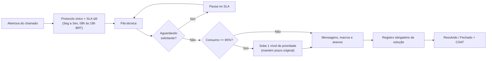
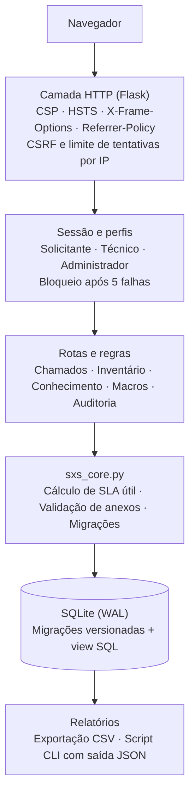
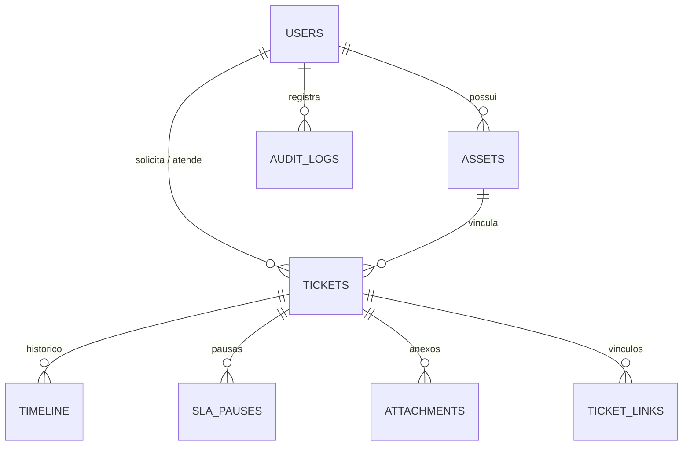

[](https://github.com/samu0752/sxs-ti/actions/workflows/ci.yml)
[](https://codecov.io/gh/samu0752/sxs-ti)

# SXS TI | Central de Chamados

Aplicação web de service desk feita em Python (Flask) e SQLite para registrar, acompanhar e encerrar chamados de TI com controle de SLA em horário comercial, inventário de equipamentos, base de conhecimento, auditoria de acesso e exportação de dados.

## Fluxo e arquitetura

### Fluxo de atendimento e SLA



### Arquitetura e segurança



### Modelo de dados



Outros diagramas (permissões e sequência) estão em [docs/DIAGRAMAS.md](docs/DIAGRAMAS.md).

## Funcionalidades principais

- **Atendimento e SLA:** abertura com protocolo sequencial, classificação (`Incidente`, `Requisição`, `Problema`), contagem de SLA apenas em minutos úteis, pausa automática quando o chamado aguarda retorno do solicitante, escalonamento automático ao atingir 85% do prazo e avaliação CSAT após fechamento.
- **Operação técnica:** fila com filtros por busca, status, categoria e prioridade, notas internas invisíveis ao solicitante, macros editáveis, vínculos entre chamados (relacionado/duplicado), base de conhecimento com sugestão por categoria e inventário de ativos (CMDB).
- **Segurança:** escopo por dono em todas as rotas para evitar IDOR, proteção CSRF com comparação em tempo constante, bloqueio de conta por 15 minutos após 5 falhas de login, limitação por IP no login e no cadastro, sessão com expiração de 8 horas, validação de assinatura de arquivos nos anexos (PNG, JPEG, PDF e UTF-8) e tela administrativa de trilha de auditoria (`/administracao/auditoria`).
- **Dados e relatórios:** painel com volume de 7 dias, categorias, carga por técnico, tempo médio de primeira resposta/resolução, cumprimento de SLA e CSAT; view SQL (`vw_relatorio_chamados`), exportação CSV com proteção contra fórmulas de planilha e script `scripts/analise_chamados.py` para gerar indicadores no terminal ou em JSON.

## Como rodar localmente

Por padrão, a aplicação inicia com o banco vazio (`LOAD_SAMPLE_DATA=0`). Com Python 3.11+ na pasta do `app.py`:

```bash
python -m pip install -r requirements.txt
python -m flask --app app criar-usuario --nome "Seu Nome" --email "voce@local.dev" --perfil administrador --usuario admin
python -m flask --app app run
```

Depois, abra `http://127.0.0.1:5000/` e faça login com o usuário criado.

- **Configuração:** veja `.env.example` e [docs/OPERACAO.md](docs/OPERACAO.md) para `SECRET_KEY`, HTTPS (`SESSION_COOKIE_SECURE=1`) e caminho do banco.
- **Escalonamento agendado:** `python -m flask --app app processar-sla`
- **Análise via CLI:**

```bash
python scripts/analise_chamados.py instance/chamados.db --escopo operacional --exportar-json kpis.json
```

## Testes e verificações

```bash
python -m pip install -r requirements-dev.txt
make test
make lint
```

O workflow em `.github/workflows/ci.yml` executa testes unitários e de integração (`unittest` + `coverage`), `ruff`, `mypy`, `bandit` e `pip-audit` em Python 3.11 e 3.13.

## Documentação

- [Relatório técnico e arquitetura](docs/relatorio-tecnico.md)
- [Modelo de ameaças STRIDE](docs/SEGURANCA.md)
- [Regras de atendimento e SLA](docs/REGRAS.md)
- [Relatórios e indicadores](docs/RELATORIOS.md)
- [Operação e deploy](docs/OPERACAO.md)
- [Changelog](CHANGELOG.md)
