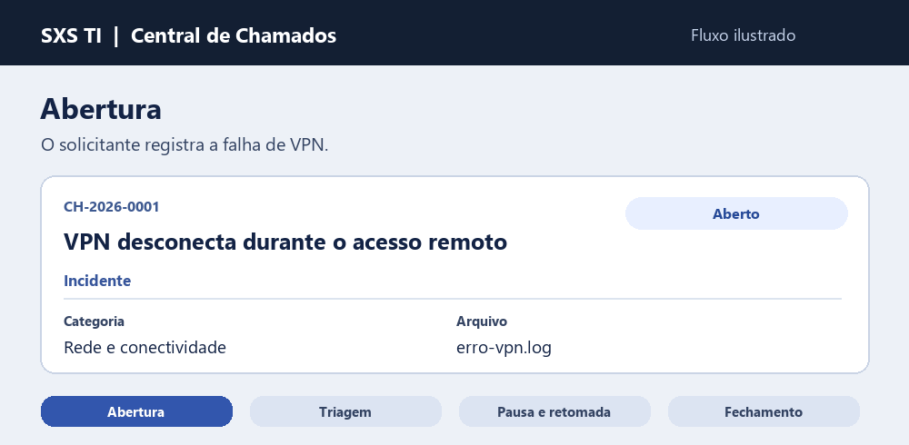

[](https://github.com/samu0752/sxs-ti/actions/workflows/ci.yml)
[](https://codecov.io/gh/samu0752/sxs-ti)

# SXS TI | Central de Chamados

## 1. Problema

Solicitações de suporte espalhadas entre mensagens e e-mails dificultam a priorização e o acompanhamento dos prazos. O SXS TI reúne protocolo, responsável, mensagens, solução, anexos e satisfação em uma ficha. Solicitantes acompanham seus próprios chamados. Técnicos operam a fila, e administradores também gerenciam contas e macros.

## 2. Demo

A [demonstração pública no Render](https://central-chamados-ti-samuel.onrender.com) usa exemplos fictícios e abre sem login. O botão **Restaurar dados fictícios** repõe os chamados de exemplo. A credencial abaixo é criada apenas no banco local pelo comando `preparar-teste`.

| Acesso | Usuário | Senha |
|---|---|---|
| Técnico de teste local | `tecnico-teste` | `SxsTiLocal-2026!` |



O Render Free pode hibernar após 15 minutos sem tráfego. A primeira abertura pode demorar, e o disco efêmero perde as alterações locais após hibernação, reinício ou redeploy. [Documentação do Render Free](https://render.com/docs/free)

## 3. Como rodar em 3 comandos

Com Python 3.11+ e no diretório que contém `app.py`:

```powershell
python -m pip install -r requirements.txt
python -m flask --app app preparar-teste
python -m flask --app app run
```

Acesse [http://127.0.0.1:5000/](http://127.0.0.1:5000/). Em um banco novo, os chamados fictícios são carregados por padrão. Para começar vazio, exporte `LOAD_SAMPLE_DATA=0` antes da primeira execução. Use um ambiente virtual para isolar as dependências quando necessário.

Para contas permanentes, use `python -m flask --app app criar-usuario`. Consulte `.env.example` e [operação](docs/OPERACAO.md) para configurar o ambiente, HTTPS, banco e processamento do SLA.

## 4. Decisões técnicas

- Flask e Jinja2 renderizam o atendimento. JavaScript sugere artigos ao selecionar a categoria e permite aplicar macros editáveis em uma resposta.
- SQLite armazena dados, anexos e eventos. As migrações são transacionais e preservam os bancos legados. O demo lê só registros fictícios. [Arquitetura](docs/relatorio-tecnico.md)
- O SLA conta minutos úteis de segunda a sexta, das 08h às 18h BRT. Espera pelo solicitante pausa a contagem. A partir de 85% do orçamento de primeira resposta pendente ou de resolução, o sistema destaca o chamado e aumenta a prioridade operacional em um nível, uma vez, preservando o prazo original. [Regras de atendimento](docs/REGRAS.md)
- Os registros JSON descrevem requisições e notificações simuladas, sem incluir e-mails, senhas ou conteúdo de chamados. A trilha administrativa e de autenticação fica no SQLite. [Modelo de ameaças](docs/SEGURANCA.md)
- A view e a exportação CSV apoiam o acompanhamento operacional. O painel mostra volume recente, categorias, carga, SLA e CSAT. [Relatórios](docs/RELATORIOS.md)

| Componente | SXS TI Python neste ZIP | Contraparte Java `sxs-ti-java` |
|---|---|---|
| Aplicação web | Flask | Spring Boot |
| Templates | Jinja2 | Thymeleaf |
| Persistência | SQLite | PostgreSQL |
| Migrações | SQL e tabela `schema_version` | Flyway |
| Escopo comparado | Implementação desta entrega | Referência de arquitetura |

## 5. Testes

```powershell
python -m pip install -r requirements-dev.txt
python -m coverage run -m unittest discover -s tests -v
python -m coverage report
```

O GitHub Actions executa os testes, publica `coverage.xml` e verifica Ruff, Mypy, Bandit e pip-audit. Os badges apontam para o repositório `samu0752/sxs-ti`. Se o nome do repositório for outro, ajuste os links. Para publicar o percentual no Codecov, configure `CODECOV_TOKEN` no GitHub.

## 6. Limitações conhecidas

- O calendário usa BRT fixo e dias úteis, sem cadastro de feriados. O escalonamento roda ao acessar a fila ou a ficha. Em operação sem tráfego, agende `flask --app app processar-sla`.
- O limitador por IP é mantido na memória de um processo. O bloqueio por conta persiste no SQLite. Distribuição entre processos exige um armazenamento compartilhado.
- O SQLite e os anexos locais atendem demonstrações e instalações pequenas. A validação de assinatura verifica o tipo do arquivo, mas não analisa o conteúdo interno de documentos.
- As notificações ficam em log JSON. O projeto não inclui envio SMTP nem a versão Java.
